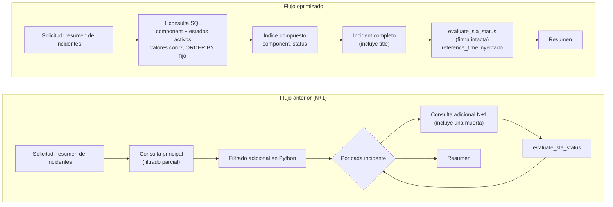

# ADR-001: Optimización de la consulta de incidentes activos (`get_active_incidents_summary`)

- **Estado**: Propuesto
- **Fecha**: 2026-11-14
- **Autor(es)**: Equipo IncidentOps
- **Componentes Afectados**: `get_active_incidents_summary`, `evaluate_sla_status` (solo como consumidor; su firma no cambia), esquema SQLite de incidentes (nuevo índice)

---

## 1. Contexto y Problema

`get_active_incidents_summary` construye el resumen de incidentes activos de un componente y evalúa el estado de SLA de cada uno. La implementación actual presenta tres problemas:

- **Patrón N+1**: además de la consulta principal, se ejecutan consultas adicionales por incidente. Una de ellas es código muerto (su resultado no se usa), por lo que solo suma latencia.
- **Filtrado tardío**: el filtrado por `component` y por estados activos no se resuelve íntegramente en SQL, de modo que se leen y materializan más filas de las necesarias.
- **Sin índice de apoyo**: no existe un índice que sirva al patrón de acceso `component` + `status`.

Restricciones que la solución debe respetar:

- Todos los **valores** viajan siempre como parámetros `?` (seguridad contra inyección SQL).
- Solo `sqlite3` de la biblioteca estándar: **sin ORM ni dependencias externas**.
- **No se altera la firma** de `evaluate_sla_status`.
- El SLA depende del horario hábil (P2/P3), de la zona horaria y de un `reference_time` inyectado; esa semántica y sus bordes deben preservarse (determinismo).
- `ORDER BY` explícito y fijo, para que el resultado sea reproducible.

---

## 2. Opciones Consideradas

1. **Opción A — Mover el cálculo de SLA a SQL**:
   - *Ventajas*: un único viaje a la base de datos; sin procesamiento posterior en Python.
   - *Desventajas*: el horario hábil de P2/P3 es difícil de expresar en SQLite; duplica la regla de negocio (SQL y Python) y rompe el determinismo del `reference_time` inyectado.
2. **Opción B — Cambiar el contrato del evaluador** (pasarle primitivos o políticas, o hacer un `JOIN` con `sla_policies`):
   - *Ventajas*: eliminaría consultas auxiliares por incidente.
   - *Desventajas*: obliga a modificar la firma de `evaluate_sla_status`, afectando a todos sus consumidores y pruebas.
3. **Opción C — Filtrar en SQL, eliminar el N+1 y mantener el SLA en Python** *(elegida)*:
   - *Ventajas*: cambio acotado y reversible; el evaluador recibe el `Incident` completo (incluido `title`) y conserva su firma; la regla de SLA tiene una única fuente de verdad.
   - *Desventajas*: el cálculo de SLA sigue en Python, por lo que el coste crece linealmente con las filas activas del componente.
4. **Opción D — Persistir `due_at`, agregar o paginar**:
   - *Ventajas*: mayor escalabilidad si el volumen crece.
   - *Desventajas*: cambia el esquema y añade complejidad de consistencia; se **difiere**, y solo se evaluará si la Opción C no alcanza los objetivos de latencia.

---

## 3. Decisión Arquitectónica

Se adopta la **Opción C**:

1. Filtrar en SQL por `component` y por los estados activos, con `ORDER BY` explícito y fijo.
2. Eliminar la consulta N+1 muerta.
3. Mantener `evaluate_sla_status` en Python, alimentado con el objeto `Incident` completo (incluido `title`).
4. Crear un índice compuesto sobre (`component`, `status`).

**Estrategia de parametrización (camino 1, propuesto)**: todos los valores, incluidos los estados activos, se pasan con `?`. La cantidad de marcadores se genera a partir de una constante interna fija (no de entrada del usuario), y los valores se envían siempre en la tupla de parámetros. Es el camino más consistente con la restricción de seguridad.

**Alternativa condicionada (camino 2)**: usar un literal en `status` y un índice parcial. Solo se adoptaría si `EXPLAIN QUERY PLAN` demuestra que el camino 1 no usa el índice de forma adecuada. *Esta elección está pendiente de confirmación.*

**Sobre `title`**: se mide la consulta con y sin `title` para decidir si conviene un índice que lo cubra; por defecto se mantiene el `Incident` completo para no cambiar el contrato del evaluador.

---

## 4. Consecuencias e Impacto

- **Positivas**:
  - Pasa de 1+N consultas a 1 por invocación.
  - Menos filas leídas y materializadas gracias al filtro y al índice.
  - La regla de SLA permanece en un solo lugar, sin duplicación SQL/Python.
  - Sin dependencias nuevas ni cambios de firma: riesgo bajo y fácil de revertir.
- **Negativas / Trade-offs**:
  - El índice añade coste en escrituras y espacio.
  - El SLA sigue evaluándose en Python, por lo que el coste crece con el número de incidentes activos del componente; si esto se vuelve limitante, se reconsiderará la Opción D (persistir `due_at`, agregar o paginar).
  - Queda abierta la elección entre camino 1 y camino 2.
- **Verificación**:
  - **Pruebas de caracterización** escritas *antes* del refactor, que fijan el resultado actual: bordes de SLA, zona horaria, horario hábil P2/P3 y `reference_time` inyectado.
  - **`EXPLAIN QUERY PLAN`** para confirmar el uso del índice (`SEARCH ... USING INDEX`) y la ausencia de `SCAN` completo ni `USE TEMP B-TREE` para el orden.
  - **Medición comparativa** (antes/después, con y sin `title`) sobre un conjunto de datos representativo.
  - Revisión de que ningún valor se concatena en el SQL: todos viajan con `?`.