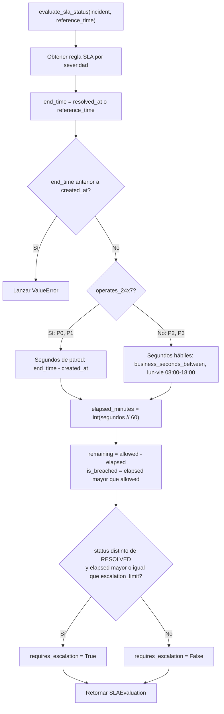

# ADR-002: Cálculo de SLA en horario hábil para incidentes P2 y P3

- **Estado**: Propuesto
- **Fecha**: 2026-11-17
- **Autor(es)**: Equipo IncidentOps
- **Componentes Afectados**: `src/sla_calculator.py` (`evaluate_sla_status` y nueva función auxiliar), `src/incident_repository.py` (consumidor en la línea 146)

---

## 1. Contexto y Problema

`evaluate_sla_status` calcula `elapsed_minutes` como la diferencia en minutos de pared entre `created_at` y el momento de cierre o de referencia, sin distinguir la severidad. Esto es correcto para P0 y P1, cuyas reglas tienen `operates_24x7=True`, pero incorrecto para P2 y P3 (`operates_24x7=False`), que solo deben consumir SLA dentro del horario hábil (lunes a viernes, 08:00–18:00, es decir, 600 minutos hábiles por día). El código actual lo deja pendiente en un `TODO`.

Consecuencias observadas:

- **Falsos vencidos**: un P2 creado el viernes a las 17:00 y evaluado el lunes a las 09:00 acumula 4.080 minutos de pared frente a un máximo de 480, y se marca como vencido, cuando en realidad solo han transcurrido 120 minutos hábiles.
- **Escalamiento omitido**: la condición actual `not is_breached` impide escalar incidentes abiertos que ya superaron su SLA, que son precisamente los que más requieren atención.
- **Cierre ambiguo**: `incident.resolved_at or reference_time` mide hasta `reference_time` si un incidente está `RESOLVED` sin `resolved_at`, lo que sigue acumulando tiempo sobre un incidente cerrado.

Restricciones del sistema:

- Solo librería estándar (`datetime` y `timedelta`), sin dependencias externas.
- Resultado determinista: mismas entradas, misma salida, sin leer el reloj del sistema.
- Datetimes *naive* en hora local de operación, sin zonas horarias.
- Los sábados y domingos no consumen SLA.

---

## 2. Opciones Consideradas

1. **Opción A — Mantener minutos de pared para todas las severidades**:
   - *Ventajas*: sin cambios de código; cálculo trivial.
   - *Desventajas*: es la causa de los falsos vencidos en fines de semana; incumple la política `operates_24x7=False`.
2. **Opción B — Mover el inicio del incidente al próximo día hábil**:
   - *Ventajas*: simple de explicar para incidentes creados en fin de semana.
   - *Desventajas*: es una regla especial que no cubre las horas fuera de ventana dentro de un día hábil ni el tramo final; añade ramas y casos límite.
3. **Opción C — Modelar «en espera de fin de semana» como estado almacenado**:
   - *Ventajas*: el estado sería visible para consumidores.
   - *Desventajas*: duplica información que se deriva del tiempo; exige jobs que cambien el estado y puede desincronizarse.
4. **Opción D — Sumar el solape del intervalo con cada ventana hábil (elegida)**:
   - *Ventajas*: una sola regla uniforme que cubre fines de semana, noches y cruces de varios días; pura y determinista; solo `datetime` y `timedelta`.
   - *Desventajas*: coste O(D) en días calendario del intervalo; no modela festivos.

---

## 3. Decisión Arquitectónica

Se adopta la **Opción D**.

### 3.1 Medición del tiempo transcurrido

- **P0 y P1** (`operates_24x7=True`): minutos de pared, como hasta ahora.
- **P2 y P3** (`operates_24x7=False`): minutos hábiles, calculados por una función auxiliar pura, p. ej. `business_seconds_between(start, end)`. Recorre día a día desde `start` hasta `end` y, para cada día de lunes a viernes, suma el solape del intervalo `[start, end]` con la ventana `[08:00, 18:00]`. Los sábados y domingos aportan cero. Cada día aporta como máximo 600 minutos.
- Se **suman segundos** y se **trunca a minutos una sola vez al final** (`int(total_segundos // 60)`), para evitar pérdida acumulada por truncar día a día.

```python
def business_seconds_between(start: datetime, end: datetime) -> float:
    """Segundos hábiles (lun-vie, 08:00-18:00) en [start, end]."""
    total = 0.0
    day = start.replace(hour=0, minute=0, second=0, microsecond=0)
    while day < end:
        if day.weekday() < 5:  # 0=lunes ... 4=viernes
            window_open = day + timedelta(hours=8)
            window_close = day + timedelta(hours=18)
            lo, hi = max(start, window_open), min(end, window_close)
            if lo < hi:
                total += (hi - lo).total_seconds()
        day += timedelta(days=1)
    return total
```

### 3.2 Escalamiento y cierre

- `requires_escalation` es verdadera si el incidente **no está `RESOLVED`** y `elapsed_minutes >= escalation_limit`, con `escalation_limit = int(max_resolution_minutes * escalation_threshold_ratio)`. Se elimina `not is_breached`: un incidente abierto y vencido sigue escalando. `is_breached` y `requires_escalation` permanecen como dos banderas independientes, sin separar flags adicionales.
- **Todo incidente `RESOLVED` lleva `resolved_at`, y ese valor detiene el reloj.** La invariante la garantiza quien cambia el estado (servicio o repositorio), no el calculador, que no añade ramas defensivas para ese caso.
- `remaining_minutes` y `allowed_minutes` se expresan en la misma unidad que `elapsed_minutes` (hábiles para P2/P3, de pared para P0/P1).

### 3.3 Diagrama



### 3.4 Decisiones pendientes

Estos puntos no están cerrados y deben resolverse antes de pasar el ADR a *Aceptado*:

1. **Evaluación histórica**: se propone `end_time = min(resolved_at, reference_time)` cuando existe `resolved_at`, de modo que evaluar «a una fecha pasada» no cuente tiempo posterior a `reference_time`.
2. **Datetimes con `tzinfo`**: definir si el calculador los rechaza explícitamente con `ValueError` o si se asume que no llegan.
3. **Datos inválidos en el repositorio**: definir cómo `incident_repository.py` trata un incidente `RESOLVED` sin `resolved_at` o con fechas incoherentes (omitir, registrar, fallar).

---

## 4. Consecuencias e Impacto

- **Positivas**:
  - Desaparecen los falsos vencidos de P2 y P3 en fines de semana y fuera de horario.
  - Los incidentes abiertos ya vencidos siguen escalando.
  - El cálculo es puro, determinista y sin dependencias externas; una sola regla cubre cualquier intervalo.
- **Negativas / Trade-offs**:
  - Coste O(D) por evaluación, con D igual a los días calendario del intervalo; aceptable para los SLA de P2/P3, pero relevante en evaluaciones masivas de incidentes muy antiguos.
  - **Festivos no modelados**: se tratan como días hábiles.
  - Sin zonas horarias: todo es hora local de operación.
  - `elapsed_minutes` cambia de semántica para P2/P3 (minutos hábiles). Los consumidores, como `incident_repository.py:146`, deben presentarlo con esa unidad.
  - La corrección depende de que el flujo de cambio de estado garantice `resolved_at` en todo `RESOLVED`.
- **Verificación**: pruebas unitarias deterministas sobre `business_seconds_between` y `evaluate_sla_status`, sin depender del reloj del sistema:

| Caso | Entrada | Resultado esperado |
|---|---|---|
| Cruce de fin de semana | P2, creado viernes 17:00, referencia lunes 09:00 | 120 min; sin vencimiento ni escalamiento |
| Solo fin de semana | P2, creado sábado 10:00, referencia domingo 20:00 | 0 min |
| Fuera de ventana | creado 07:00 o 19:00 un día hábil | no cuenta tiempo fuera de 08:00–18:00 |
| Límites de ventana | referencia exacta a las 08:00 y a las 18:00 | 0 y 600 min, respectivamente, en un día completo |
| Varios días y semanas | P3 abierto durante más de una semana | máximo 600 min por día hábil, 0 en fines de semana |
| Umbral de escalamiento | P2 abierto con 360 min hábiles (`int(480 * 0.75)`) | `requires_escalation = True` |
| Vencido y abierto | P2 abierto con más de 480 min hábiles | `is_breached = True` y `requires_escalation = True` |
| Incidente resuelto | `RESOLVED` con `resolved_at` | el reloj se detiene; `requires_escalation = False` |
| P0 / P1 | 61 min de pared en P0; cruce de fin de semana en P1 | minutos de pared; P0 vencido |
| Fechas incoherentes | `end_time` anterior a `created_at` | `ValueError` |

  Además, el caso de referencia en `sla_calculator.py:87` (lunes 2026-11-09 09:00) debe seguir ejecutándose sin cambios de firma.