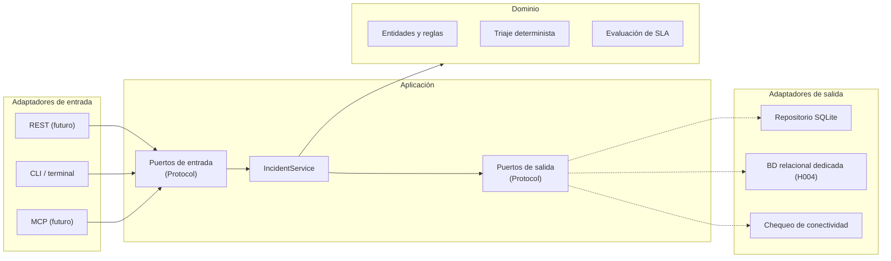

# ADR-003: Adopción de Arquitectura Hexagonal (Puertos y Adaptadores) para IncidentOps

- **Estado**: Propuesto
- **Fecha**: 2026-11-21
- **Autor(es)**: Equipo IncidentOps
- **Reemplaza a**: *(Ninguno; complementa ADR-001 y ADR-002 sin reemplazarlos)*

---

## 1. Contexto y Problema

IncidentOps debe ofrecer el mismo comportamiento de triaje, consulta de incidentes activos y auditoría de SLA a través de interfaces distintas (web, terminal y, a futuro, MCP), y debe poder cambiar de motor de persistencia sin reescribir las reglas de negocio. El código actual concentra esa lógica en módulos que mezclan dominio, acceso a datos y presentación: el repositorio SQLite no solo persiste, sino que también orquesta la evaluación de SLA y el armado del resumen; el triaje y el cálculo de SLA son funciones puras, pero no existe una frontera explícita que impida que las interfaces o la base de datos se filtren hacia el dominio.

La decisión estructural y difícil de revertir es **cómo se organizan las dependencias**: si el dominio depende de las interfaces y del motor de base de datos, o si son las interfaces y la base de datos quienes dependen del dominio. Esta elección condiciona los hitos H001–H004 (misma clasificación desde cualquier interfaz, resumen consistente, ciclo de vida persistente y runtime con base de datos dedicada e intercambiable).

Restricciones vigentes:

- **Determinismo**: el tiempo de referencia se inyecta y los datetimes son naive; el dominio no lee el reloj del sistema.
- **Cero dependencias externas** más allá de las ya declaradas: hoy solo `sqlite3` de la biblioteca estándar para persistencia.
- **Contratos de interfaz aún no definidos**: la arquitectura no debe fijar rutas HTTP, esquemas de transporte ni bibliotecas de framework.
- **Seguridad**: los valores de consulta viajan parametrizados; ninguna entrada de usuario se interpola en SQL.
- Las reglas de negocio de SLA y de triaje ya fijadas por ADR-001 y ADR-002 deben preservarse íntegras.

---

## 2. Opciones Consideradas

1. **Opción A — Arquitectura en capas tradicional acoplada a FastAPI y SQLite**:
   - *Ventajas*: es el camino más corto y familiar; los routers, servicios y repositorios se escriben directamente contra FastAPI y `sqlite3`, con poco andamiaje; menor curva de aprendizaje y menos archivos.
   - *Desventajas*: el dominio queda acoplado al framework y al motor de base de datos; cambiar de interfaz (terminal, MCP) o de base de datos (H004) obliga a tocar las capas de negocio; las reglas deterministas de triaje y SLA quedan difíciles de probar sin levantar la infraestructura; el acoplamiento es costoso de revertir una vez que las interfaces crecen.

2. **Opción B — Arquitectura Hexagonal (Puertos y Adaptadores)**:
   - *Ventajas*: el dominio y los casos de uso no dependen de web, terminal ni base de datos; las interfaces y los motores de persistencia son intercambiables detrás de puertos; el mismo caso de uso se reutiliza en web, CLI y futuro MCP; el dominio determinista se prueba de forma aislada; prepara la sustitución de SQLite por una base relacional dedicada sin reescribir reglas.
   - *Desventajas*: introduce más indirección y archivos (puertos, servicios, adaptadores, mapeos); exige disciplina para que el dominio no importe framework ni `sqlite3`; hay riesgo de sobreingeniería si se crean puertos antes de que exista una segunda implementación real.

---

## 3. Decisión Arquitectónica

Se adopta la **Opción B: Arquitectura Hexagonal**, con estas fronteras:

- **`src/domain/`**: entidades y reglas puras (triaje determinista, evaluación de SLA). No conoce interfaces, frameworks ni motores de base de datos.
- **`src/application/`**: los casos de uso expuestos mediante puertos definidos con `typing.Protocol` y orquestados por un `IncidentService`. Define los puertos de entrada que consumen las interfaces y los puertos de salida que implementa la infraestructura.
- **`src/adapters/inbound/`**: adaptadores de entrada (REST, CLI y futuro MCP) que traducen solicitudes externas a llamadas del `IncidentService`.
- **`src/adapters/outbound/`**: adaptadores de salida (repositorio SQLite actual, repositorio sobre base relacional dedicada para H004 y chequeo de conectividad operativa) que implementan los puertos de salida.

Se elige esta opción porque la dirección de dependencias queda forzada hacia el dominio: los adaptadores dependen de la aplicación, la aplicación depende del dominio y el dominio no depende de nadie. Eso permite que H001 y H002 compartan exactamente la misma clasificación y el mismo resumen entre web y terminal, que H003 mantenga el ciclo de vida y la auditoría de SLA en el dominio, y que H004 sustituya el motor de persistencia sin tocar las reglas de negocio. Los puertos con `typing.Protocol` no agregan dependencias en tiempo de ejecución y preservan el determinismo, ya que el tiempo de referencia sigue inyectándose desde el borde.

La dirección de dependencias es siempre hacia adentro: los adaptadores de entrada y salida apuntan a la aplicación, la aplicación apunta al dominio, y el dominio no conoce a ninguno de los dos.

---

## 4. Consecuencias y Trade-offs

- **Positivas**: el dominio de triaje y SLA queda desacoplado de web, terminal, MCP y del motor de base de datos; el mismo caso de uso se reutiliza en todas las interfaces (H001, H002); la persistencia es intercambiable y el chequeo de conectividad se integra como un adaptador más (H004); las reglas deterministas se prueban sin infraestructura; el cambio de rumbo en interfaces o base de datos deja de ser costoso.
- **Negativas / Trade-offs**: mayor cantidad de piezas y mapeos entre adaptadores y dominio; complejidad inicial para un proyecto pequeño; exige disciplina y revisión para que el dominio no importe frameworks ni `sqlite3`; el valor pleno de los puertos aparece cuando existe una segunda implementación real (otra interfaz u otro motor), por lo que parte de la inversión se recupera recién en H002–H004.
