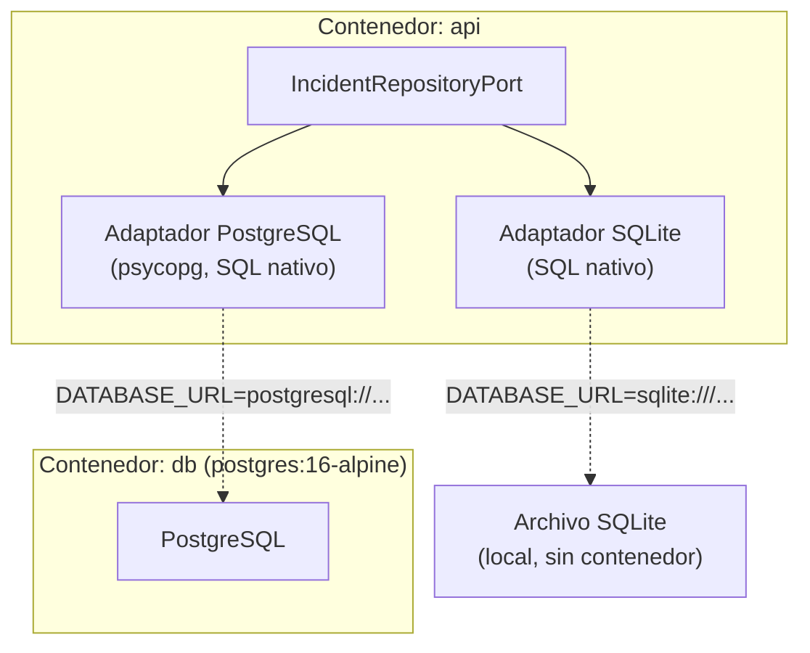

# ADR-004: Persistencia dual SQLite/PostgreSQL sin ORM y runtime multi-contenedor

- **Estado**: Aceptado
- **Fecha**: 2026-11-24
- **Autor(es)**: Equipo IncidentOps
- **Reemplaza a**: `ADR-001` (parcial) — sustituye únicamente la restricción de contexto "solo `sqlite3` de la biblioteca estándar, sin ORM ni dependencias externas"; la decisión de optimización de consulta de ADR-001 (filtrado en SQL, eliminación del N+1, índice compuesto `component`+`status`) permanece vigente y no se modifica.

---

## 1. Contexto y Problema

IncidentOps persiste hoy exclusivamente en SQLite embebido: `src/adapters/outbound/factory.py`
construye el repositorio a partir de `DATABASE_URL` y solo acepta el esquema `sqlite:///`,
rechazando cualquier otro con un error explícito que remite a que "cambiar de motor exige un
ADR aprobado previamente". SQLite embebido en un único archivo/proceso serializa las escrituras
(un solo *writer* a la vez), lo que limita la capacidad de ejecutar varias instancias de la API
escribiendo concurrentemente contra el mismo almacenamiento en un entorno de producción real.

Restricciones vigentes que la solución debe respetar:

- La frontera hexagonal (ADR-003) exige que el motor concreto quede encapsulado detrás de
  `IncidentRepositoryPort`; el dominio y la aplicación nunca conocen el motor de persistencia.
- Todo valor viaja parametrizado (nunca interpolado en el SQL), consistente con ADR-001.
- Los `datetime` del dominio son siempre *naive* (sin `tzinfo`) y su comparación debe ser
  idéntica sin importar el motor de almacenamiento subyacente.
- `DATABASE_URL` sigue siendo el único punto de selección del motor; hoy solo admite el
  esquema `sqlite:///`, y la ejecución local ligera (`sqlite:///:memory:`, sin contenedores)
  es valiosa para desarrollo y pruebas y no debe perderse.

---

## 2. Opciones Consideradas

1. **Opción A — SQLite embebido único con volumen persistente en contenedor**:
   - *Ventajas*: cero dependencias nuevas; topología de despliegue trivial (un solo contenedor);
     continuidad total con ADR-001.
   - *Desventajas*: la escritura serializada de SQLite no desaparece por estar en un contenedor;
     no permite escalar horizontalmente la API a varias réplicas escribiendo a la vez, y bajo
     concurrencia de escritura real en producción el riesgo de bloqueos (`database is locked`)
     aumenta con el tráfico.

2. **Opción B — Migración exclusiva a PostgreSQL con ORM (SQLAlchemy)**:
   - *Ventajas*: abstracción de motor y migraciones declarativas con herramientas maduras del
     ecosistema; elimina la necesidad de mantener dos implementaciones de repositorio.
   - *Desventajas*: introduce una capa de mapeo objeto-relacional sobre un SQL nativo
     parametrizado que ya funciona bien (ADR-001), con su propio overhead de aprendizaje y
     abstracción; obliga a reescribir el repositorio SQLite existente en vez de conservarlo, y
     elimina la ejecución local ultraligera sin contenedores que hoy ofrece `sqlite:///:memory:`
     para desarrollo y pruebas rápidas.

3. **Opción C — Persistencia dual SQLite/PostgreSQL con SQL nativo y runtime multi-contenedor**
   *(elegida)*:
   - *Ventajas*: conserva SQLite para desarrollo y pruebas (ejecución local sin contenedores) y
     añade PostgreSQL para producción con concurrencia de escritura real; ambos motores
     implementan el mismo `IncidentRepositoryPort` con SQL nativo parametrizado, sin ORM,
     preservando la decisión de ADR-001; la selección sigue centralizada en `DATABASE_URL`.
   - *Desventajas*: dos implementaciones de repositorio a mantener en paridad de comportamiento
     (incluida la representación de timestamps); incorpora una dependencia externa nueva
     (`psycopg[binary]`) donde antes solo se permitía la biblioteca estándar.

---

## 3. Decisión Arquitectónica

Se adopta la **Opción C**: persistencia dual SQLite/PostgreSQL sin ORM, con las siguientes
decisiones estructurales:

1. **Driver nativo para PostgreSQL**: acceso mediante `psycopg[binary]`, con SQL nativo
   parametrizado (`?`/`%s` según motor), sin capa de ORM, en continuidad directa con el
   enfoque de acceso a datos adoptado en ADR-001.
2. **Selección dinámica de motor**: `DATABASE_URL` sigue siendo el único punto de cableado;
   el esquema de la URL (`sqlite:///` vs. `postgresql://`) determina qué implementación de
   `IncidentRepositoryPort` se construye, sin que el dominio ni la aplicación lo perciban.
3. **Timestamps como ISO 8601 en columnas `TEXT`**: en ambos motores, las fechas-hora se
   almacenan como texto ISO 8601 en vez de tipos nativos de fecha-hora, para garantizar
   paridad exacta de comparación y ordenamiento entre SQLite y PostgreSQL sin depender de
   conversiones de tipo específicas de cada motor.
4. **Runtime multi-contenedor**: el despliegue productivo pasa de un único proceso a una
   topología de Docker Compose con dos servicios — `api` (la aplicación) y `db` (PostgreSQL,
   imagen `postgres:16-alpine`) — manteniendo la posibilidad de ejecutar `api` sola, sin
   Compose, contra `sqlite:///:memory:` para desarrollo local y pruebas.

---

## 4. Consecuencias y Trade-offs

- **Positivas**:
  - Habilita el escalado horizontal de la API en producción (varias réplicas pueden escribir
    concurrentemente contra PostgreSQL) sin renunciar a la ejecución local ligera para
    desarrollo y pruebas.
  - Mantiene intacta la frontera hexagonal (ADR-003): ambos adaptadores de salida implementan
    el mismo puerto y el motor concreto nunca se filtra hacia el dominio o la aplicación.
  - Preserva la ausencia de ORM de ADR-001: el acceso a datos sigue siendo SQL nativo
    parametrizado en ambos motores.
  - La representación ISO 8601/`TEXT` elimina divergencias de comparación de fechas entre
    motores, sin lógica condicional adicional en el dominio.

- **Negativas / Trade-offs**:
  - Reemplaza parcialmente la restricción de ADR-001 de "sin dependencias externas": se
    incorpora `psycopg[binary]` como nueva dependencia del proyecto.
  - Duplica el esfuerzo de mantenimiento: cada implementación concreta del repositorio debe
    verificarse por separado para garantizar paridad de comportamiento entre motores.
  - La topología multi-contenedor añade complejidad operativa (orquestación con Docker
    Compose, gestión del ciclo de vida del servicio `db`) que no existía con SQLite embebido.
  - Almacenar timestamps como `TEXT` renuncia a los tipos e índices nativos de fecha-hora de
    PostgreSQL, a cambio de paridad exacta entre motores.
